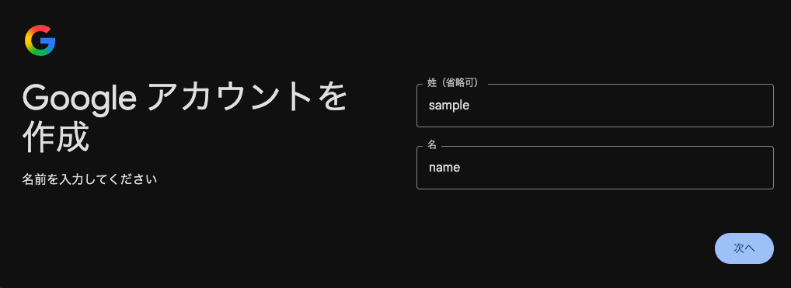
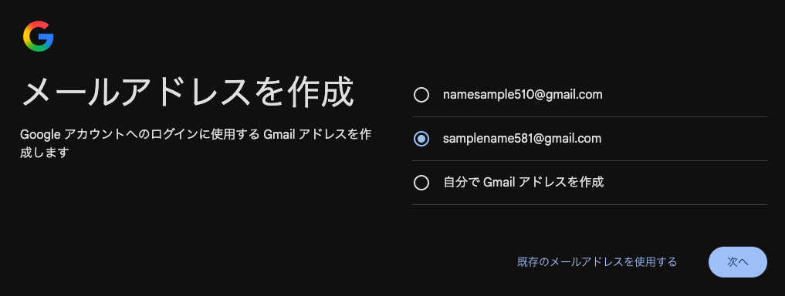
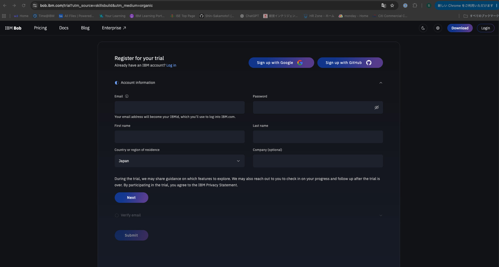
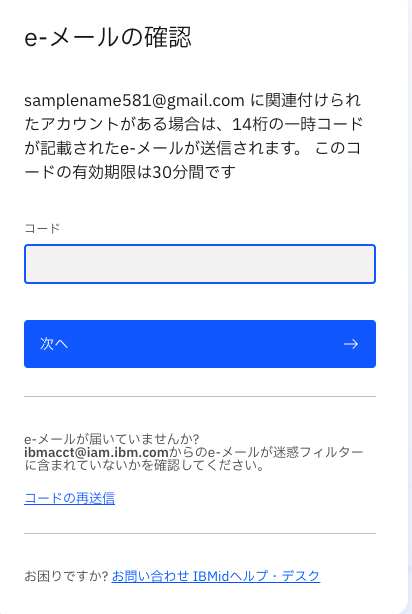
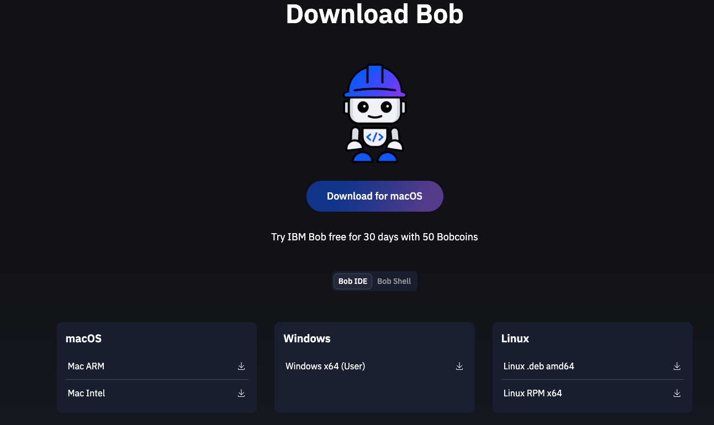
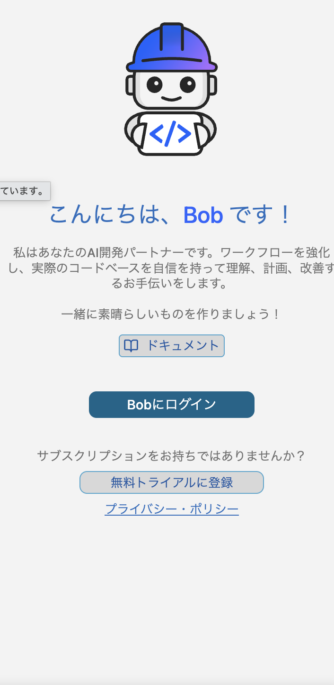
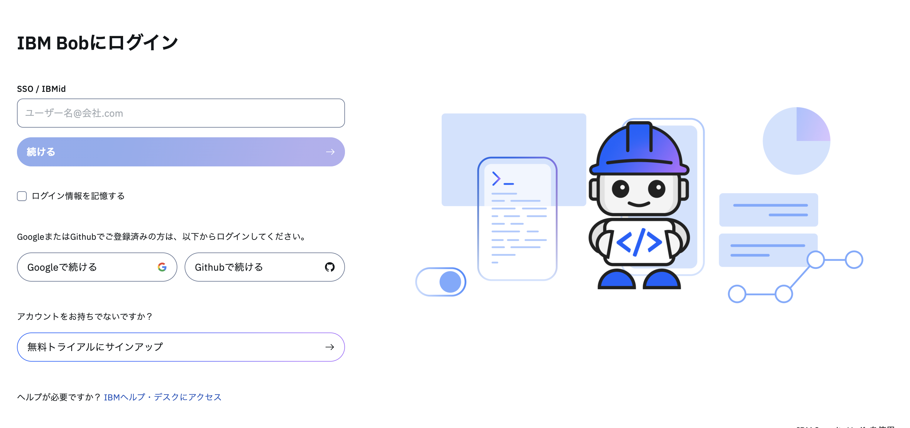

# IBM Bob 開発環境構築手順（Googleアカウント作成〜サインイン）

本書は、Googleアカウントを新規作成し、そのアカウントでIBM Bobの無料トライアルへサインアップして、Bob IDEをダウンロード・サインインするまでの手順を、画面キャプチャ付きで説明する。

## 1. 全体の流れ

| 手順 | 内容 | 使用する画面 |
|---|---|---|
| 1 | Googleアカウントを作成する | Googleアカウント作成画面 |
| 2 | IBM Bobの無料トライアルへサインアップする | `bob.ibm.com/trial` |
| 3 | メールアドレスを確認する（IBMid登録） | e-メールの確認画面 |
| 4 | Bob IDEをダウンロード・インストールする | Download Bob |
| 5 | Bob IDEからサインインする | Bobの初期画面、IBM Bobにログイン画面 |

## 2. 前提条件

- インターネットに接続でき、Webブラウザー（Chromeなど）が利用できること。
- メールを受信できること（手順3で確認コードを受け取る）。
- 無料トライアルは、画面上に「Try IBM Bob free for 30 days with 50 Bobcoins」（30日間・50 Bobcoins）と案内されている。条件は変更される場合があるため、最新情報は公式サイトで確認すること。

> 既にGoogleアカウントまたはGitHubアカウントをお持ちの場合は、手順1を省略して手順2へ進める。

## 3. Googleアカウントを作成する

### 3.1 名前を入力する

Googleアカウント作成画面で、姓（省略可）と名を入力し、［次へ］を押す。

### 3.2 Gmailアドレスを作成する

Googleアカウントへのログインに使うGmailアドレスを選ぶ。候補から選択するか、［自分で Gmail アドレスを作成］を選んで任意のアドレスを指定し、［次へ］を押す。

> 既存のメールアドレスを使う場合は、［既存のメールアドレスを使用する］を選択する。

以降、画面の案内（パスワード設定、本人確認など）に従ってGoogleアカウントの作成を完了する。

## 4. IBM Bobへサインアップする

### 4.1 トライアル登録画面を開く

ブラウザーで `https://bob.ibm.com/trial` を開く。「Register for your trial」画面が表示される。

登録方法は次の3通りである。

| 方法 | 操作 |
|---|---|
| Googleアカウントで登録（本手順） | 画面右上の［Sign up with Google］を押し、手順3で作成したGoogleアカウントを選択する |
| GitHubアカウントで登録 | ［Sign up with GitHub］を押す |
| メールアドレスで登録 | Email、Password、First name、Last name、Country or region of residenceを入力し、［Next］を押す |

画面の注記のとおり、入力したメールアドレスがIBMidとなり、IBM.comへのログインに使用される。

### 4.2 メールアドレスを確認する

登録したメールアドレス宛てに、14桁の一時コードが記載されたe-メールが送信される。メールを確認し、「コード」欄に入力して［次へ］を押す。

注意事項：

- コードの有効期限は30分間である。
- メールが届かない場合は、`ibmacct@iam.ibm.com` からのメールが迷惑メールフィルターに入っていないか確認する。
- 期限切れや未着の場合は、［コードの再送信］を押す。

コードの確認後、画面の案内に従って登録（Submit）を完了する。

## 5. Bob IDEをダウンロードする

`bob.ibm.com` の［Download］から「Download Bob」画面を開き、利用するOSに合わせてインストーラーを入手する。

| OS | 選択するインストーラー |
|---|---|
| macOS（Apple Silicon） | Mac ARM |
| macOS（Intel） | Mac Intel |
| Windows | Windows x64 (User) |
| Linux（Debian系） | Linux .deb amd64 |
| Linux（RPM系） | Linux RPM x64 |

- 画面上部の切り替えで、［Bob IDE］と［Bob Shell］から製品を選べる。本手順では **Bob IDE** を使用する。
- ご利用のMacがApple SiliconかIntelかは、画面左上のAppleメニューの「このMacについて」で確認できる。
- ダウンロードしたファイルを実行（macOSはアプリケーションフォルダーへ移動）してインストールし、Bobを起動する。

## 6. Bob IDEへサインインする

### 6.1 Bobの初期画面でログインを開始する

Bobを起動すると「こんにちは、Bob です！」の画面が表示される。［Bobにログイン］を押す。

> サブスクリプションをお持ちでない場合は、同じ画面の［無料トライアルに登録］からも登録できる。

### 6.2 登録済みのアカウントでログインする

ブラウザーに「IBM Bobにログイン」画面が表示される。手順4で登録した方法に合わせて、次のいずれかでログインする。

| 登録方法 | ログイン操作 |
|---|---|
| Googleアカウント | ［Googleで続ける］を押し、登録に使ったGoogleアカウントを選択する |
| GitHubアカウント | ［Githubで続ける］を押す |
| IBMid（メールアドレス） | 「SSO / IBMid」欄にメールアドレスを入力し、［続ける］を押す |

- 次回以降の入力を省略したい場合は、［ログイン情報を記憶する］にチェックを入れる。
- アカウントをお持ちでない場合は、［無料トライアルにサインアップ］から登録できる。
- ログインに失敗する場合は、画面下部の「IBMヘルプ・デスクにアクセス」から問い合わせる。

ログインが完了するとブラウザーからBobへ戻り、Bob IDEが利用可能になる。以上で開発環境の構築は完了である。

## 7. トラブルシューティング

| 症状 | 確認事項 |
|---|---|
| 確認コードのメールが届かない | 迷惑メールフォルダーを確認する。`ibmacct@iam.ibm.com` を受信拒否していないか確認し、［コードの再送信］を実行する |
| 確認コードが無効と表示される | 有効期限（30分間）を過ぎていないか、最新のコードを入力しているか確認する |
| ログインできない | 登録時と同じ方法（Google／GitHub／IBMid）でログインしているか確認する |
| インストーラーが起動しない | OSとCPUアーキテクチャー（Mac ARM／Intel、Windows x64など）が合っているか確認する |
