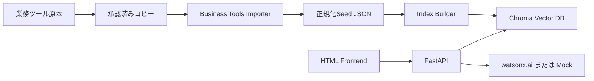
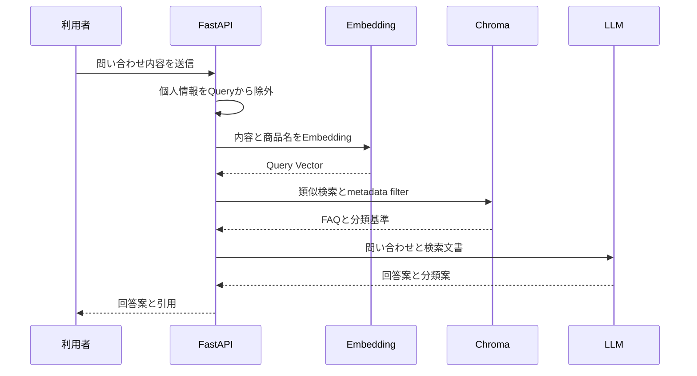

# 業務ツール取込・RAG連携 修正設計書

## 1. 目的

`ohno/業務で使用するツール`にある次の教材を、Helpdesk RAG Starterの入力データとして取り込めるようにする。

- `FAQ回答集.xlsx`
- `問い合わせ分類基準表.xlsx`
- `問い合わせ管理シート.xlsx`
- `問い合わせフォーム.html`

FAQと分類基準をChromaの検索対象にし、問い合わせ管理シートをTicket初期データ、分類値をMaster、問い合わせフォームの項目をFrontendとTicket APIへ反映する。

本書は修正設計であり、この時点では実装、データコピー、既存Seedの置換を行わない。

## 2. 設計上の結論

1. 実行時に`../ohno`を参照しない。承認済みの4ファイルを`sample_asset/assets/source/business_tools/`へコピーして、repository単体で再生成可能にする。
2. Excelをアプリケーション起動時に直接読み込まない。専用Import Scriptで検証・正規化し、既存のJSON Seedへ変換する。
3. `FAQ回答集.xlsx`と`問い合わせ分類基準表.xlsx`をRAG検索対象にする。
4. `問い合わせ管理シート.xlsx`の「問い合わせ一覧」をTicket Seedとして使用し、「集計」は取り込まない。
5. `問い合わせフォーム.html`をそのまま配信せず、入力項目とValidationを既存Frontend／FastAPIへ移植する。
6. 氏名、メールアドレス、注文番号、添付ファイルをEmbedding、Chroma、LLM Promptへ含めない。
7. 既存のITヘルプデスク文書と家具販売問い合わせ文書は混在させない。新しい業務ツールからSeedを再生成して置き換える。

## 3. 現行実装との差分

| 対象 | 現行 | 修正後 |
|---|---|---|
| 検索文書 | `helpdesk_documents.xlsx` | FAQ回答集＋分類基準表 |
| Ticket | IT部門向けのTicket項目 | 顧客、注文、商品、対応区分、FAQ番号を追加 |
| Master | ITカテゴリ、優先度、担当チーム | 家具問い合わせのカテゴリ、緊急度、担当 |
| Frontend | 汎用Ticket／RAG画面 | 問い合わせフォーム項目を追加 |
| Import | 3つの既存Excel専用 | 業務ツール4ファイル用Importerを追加 |
| 個人情報 | 部署名が中心 | 氏名、メール、注文番号を分離して保護 |
| 配布単位 | `sample_asset`単体 | 変更なし。親ディレクトリへ依存しない |

## 4. 入力ファイル調査結果

### 4.1 FAQ回答集.xlsx

- Sheet: `FAQ回答集`
- Header: 4行目
- Data: 5行目以降、15件
- Columns: `FAQ番号`、`カテゴリ`、`よくある質問`、`回答文（ひな形）`、`窓口で完結`、`最終更新日`

カテゴリは次の5種類である。

- 配送関連
- 商品不良・破損
- 組み立て・使い方
- 注文変更・キャンセル
- 店舗・在庫・その他

### 4.2 問い合わせ分類基準表.xlsx

#### Sheet: カテゴリ

- Header: 4行目
- Data: 5行目以降、5件
- Columns: `カテゴリ`、`問い合わせの例`、`見分けるキーワード`、`対応先`、`補足`

#### Sheet: 緊急度

- Header: 4行目
- Data: 5行目以降、3件
- Columns: `緊急度`、`判断の目安`、`例`、`着手の目安`

### 4.3 問い合わせ管理シート.xlsx

#### Sheet: 問い合わせ一覧

- Header: 4行目
- Data: 5行目以降、20件
- Columns: `受付番号`、`受付日時`、`お客様名`、`注文番号`、`商品名`、`問い合わせ内容（要約）`、`カテゴリ`、`緊急度`、`対応区分`、`担当`、`ステータス`、`FAQ番号`、`備考`
- 20件中6件はカテゴリ等が未判定であり、RAG演習用の入力として維持する。

#### Sheet: 集計

Excel数式で生成される表示用集計である。正規化データの正本にはせず、Import対象外とする。

### 4.4 問い合わせフォーム.html

入力項目は次のとおりである。

| 項目 | 必須 | 取扱い |
|---|---:|---|
| お名前 | 必須 | Ticketに保存。Vector／Prompt対象外 |
| メールアドレス | 必須 | Ticketに保存。Vector／Prompt対象外 |
| 注文番号 | 任意 | Ticketに保存。Vector／Prompt対象外 |
| 商品名 | 任意 | Ticketと検索Queryに利用可能 |
| お問い合わせの種類 | 必須 | Masterから選択 |
| お問い合わせ内容 | 必須 | RAG検索Queryに利用 |
| 写真 | 任意 | Runtimeへ分離保存。Vector／Prompt対象外 |

現行HTMLはBrowser内で受付番号を採番し、外部へ送信しない。修正後は受付番号をBackendで排他的に採番し、FastAPIへ送信する。

## 5. 修正後の全体構成



### 5.1 RAG処理経路



## 6. ディレクトリ構成

```text
sample_asset/
├── assets/source/business_tools/
│   ├── faq_answers.xlsx
│   ├── inquiry_classification.xlsx
│   ├── inquiry_management.xlsx
│   └── inquiry_form.html
├── backend/scripts/
│   ├── import_business_tools.py
│   ├── export_seed_data.py
│   └── build_index.py
├── data/seed/
│   ├── documents.json
│   ├── masters.json
│   ├── tickets.json
│   └── tickets_student.json
├── data/evaluation/
│   └── ticket_gold.json
└── data/runtime/
    ├── tickets.json
    └── attachments/
```

原本名とrepository内のファイル名は次のように対応させる。

| 原本名 | repository内の名前 |
|---|---|
| `FAQ回答集.xlsx` | `faq_answers.xlsx` |
| `問い合わせ分類基準表.xlsx` | `inquiry_classification.xlsx` |
| `問い合わせ管理シート.xlsx` | `inquiry_management.xlsx` |
| `問い合わせフォーム.html` | `inquiry_form.html` |

ASCII名を使用してMac／WindowsのShell、ZIP、CIでの文字コード差異を避ける。変換後の`source` metadataには原本名、Sheet名、行番号を保持する。

## 7. Importer設計

### 7.1 Interface

新規Scriptを次のInterfaceで実装する。

```bash
uv run python backend/scripts/import_business_tools.py validate
uv run python backend/scripts/import_business_tools.py export
uv run python backend/scripts/import_business_tools.py export --source-dir ./assets/source/business_tools
```

| Command | 動作 |
|---|---|
| `validate` | 読み取りとValidationのみ。出力ファイルを変更しない |
| `export` | 一時ディレクトリに全JSONを生成し、全検証成功後に一括置換 |
| `--source-dir` | Import元を変更する。省略時はrepository内の標準パス |

一部ファイルだけを更新する機能は初期実装へ含めない。文書、Master、Ticket間の参照整合性を保つため、常に一括変換する。

### 7.2 Excel読み取り規則

1. Sheet名を完全一致で確認する。
2. 先頭10行以内から必須Header集合が一致する行を探す。
3. Header行番号を固定値だけに依存させず、説明行の増減を許容する。
4. 主キー列が空の行はData終了後の空行として無視する。
5. 前後空白、全角空白だけの値、Excelの`—`を正規化する。
6. 日付はtimezone付きISO 8601、日付のみなら`YYYY-MM-DD`へ変換する。
7. Excel数式の計算は行わず、`data_only=True`で保存済み結果を読む。
8. `集計`Sheetは読み込まない。

### 7.3 共通Validation

- 必須Sheetと必須Columnが存在すること
- IDが空でなく、ファイル内で一意であること
- FAQのカテゴリがカテゴリMasterに存在すること
- TicketのFAQ番号がFAQに存在するか、未設定であること
- Ticketのカテゴリ、緊急度、担当、ステータスが許可値か、未設定であること
- 日付を変換できること
- セル文字列がモデルの最大長以下であること
- Excel Macro、外部Link、埋め込みObjectを実行しないこと

エラーには秘密情報やセル本文を出さず、`file`、`sheet`、`row`、`column`、`error_code`を出力する。

## 8. データ変換設計

### 8.1 FAQからdocuments.json

| Excel | documents.json | 変換 |
|---|---|---|
| FAQ番号 | `document_id` | `faq:`を付与する。例: `faq:FAQ-01` |
| よくある質問 | `title` | 前後空白を除去 |
| 回答文（ひな形） | `body` | 質問、回答、窓口完結条件を構造化して格納 |
| カテゴリ | `category` | Masterと一致させる |
| 最終更新日 | `updated_at` | `YYYY-MM-DD` |
| 窓口で完結 | metadata | `completion_policy`として保持 |
| Sheet／行 | `source` | `FAQ回答集.xlsx#FAQ回答集!5`形式 |

生成例:

```json
{
  "document_id": "faq:FAQ-04",
  "title": "配送日を変更したい",
  "body": "質問: 配送日を変更したい\n回答: ...\n窓口対応: いいえ（配送センター担当）",
  "document_type": "faq",
  "source": "FAQ回答集.xlsx#FAQ回答集!8",
  "category": "配送関連",
  "updated_at": "2026-10-01",
  "access_scope": "student",
  "is_active": true,
  "metadata": {
    "faq_id": "FAQ-04",
    "completion_policy": "いいえ（配送センター担当）"
  }
}
```

既存`ChunkRecord`は任意metadataを保持できないため、次のどちらかを実装時に選択する。

- 推奨: `ChunkRecord`へ`metadata: dict[str, scalar]`を追加する。
- 最小変更: `faq_id`と`completion_policy`を個別fieldとして追加する。

無制限の任意辞書は型とOpenAPIが曖昧になるため、初期実装では個別fieldを推奨する。

### 8.2 分類基準からdocuments.json

カテゴリ1件につき1文書、緊急度1件につき1文書を生成する。

| Sheet | document_type | document_id |
|---|---|---|
| カテゴリ | `classification_rule` | `classification:category:<連番>` |
| 緊急度 | `priority_rule` | `classification:priority:<連番>` |

カテゴリ文書の本文には、カテゴリ、問い合わせ例、キーワード、対応先、補足を含める。緊急度文書の本文には、緊急度、判断の目安、例、着手の目安を含める。

### 8.3 分類基準からmasters.json

```json
{
  "categories": [],
  "priorities": [],
  "support-teams": [],
  "statuses": [],
  "handling-types": [],
  "inquiry-types": []
}
```

| Master | 生成元 |
|---|---|
| `categories` | カテゴリSheet |
| `priorities` | 緊急度Sheet |
| `support-teams` | カテゴリSheetの対応先＋管理シートの担当 |
| `statuses` | 管理シートのステータス |
| `handling-types` | 管理シートの対応区分 |
| `inquiry-types` | HTMLフォームのradio値 |

IDは表示名から都度生成せず、Importer内の明示的な対応表で安定したIDを割り当てる。未知の表示値が追加された場合は自動採番せずValidation Errorとし、対応表の更新を要求する。

### 8.4 管理シートからtickets.json

| Excel | Ticket field | 備考 |
|---|---|---|
| 受付番号 | `ticket_id` | 原値を維持 |
| 受付日時 | `created_at` | JSTのISO 8601 |
| お客様名 | `customer_name` | Sensitive field |
| 注文番号 | `order_number` | `—`はnull |
| 商品名 | `product_name` | `—`はnull |
| 問い合わせ内容（要約） | `description` | RAG Query対象 |
| カテゴリ | `category` | 未判定はnull |
| 緊急度 | `priority` | 未判定はnull |
| 対応区分 | `handling_type` | 未判定はnull |
| 担当 | `assigned_team` | 未判定はnull |
| ステータス | `status` | 必須 |
| FAQ番号 | `faq_id` | FAQへの参照。未設定可 |
| 備考 | `notes` | Promptへは原則含めない |

既存`title`は互換性のため維持し、`商品名 + 問い合わせ内容の先頭部分`からImporterが生成する。`requester_department`は新規データでは使用しないためnullableに変更し、将来削除候補としてDeprecated扱いにする。

### 8.5 Student用と評価用の分離

`tickets_student.json`では正解に相当する次のfieldをnullまたは除外する。

- `category`
- `priority`
- `handling_type`
- `assigned_team`
- `faq_id`
- 判定根拠を含む`notes`

正解値は`data/evaluation/ticket_gold.json`へ分離する。通常起動では`tickets_student.json`を使用し、評価DataをAPIやFrontendから配信しない。現行Repositoryが`tickets.json`を読むため、`TICKET_SEED_FILE`設定を追加し、既定値を`tickets_student.json`へ変更する。

## 9. Domain Model修正

Ticketへ次を追加する。

```text
customer_name: string
customer_email: string or null
order_number: string or null
product_name: string or null
inquiry_type: string or null
handling_type: string or null
faq_id: string or null
notes: string or null
has_attachment: boolean
```

Validation方針:

- `customer_name`: 1から100文字
- `customer_email`: Email形式、254文字以下
- `order_number`: `^[A-Z0-9-]{1,40}$`またはnull
- `product_name`: 200文字以下
- `inquiry_type`: Masterのallow-list
- `description`: 1から4,000文字
- `faq_id`: `^FAQ-[0-9]{2,4}$`またはnull
- APIの余分なfieldは拒否する

## 10. API・Frontend修正

### 10.1 Ticket作成API

`POST /api/v1/tickets`へフォーム項目を追加する。受付番号、作成日時、ステータス、VersionはBackendが生成し、Browserから受け取らない。

JSON作成APIは維持する。画像添付は責務を分離して次のAPIを追加する。

```text
POST /api/v1/tickets/{ticket_id}/attachments
Content-Type: multipart/form-data
```

初期実装で許可する形式はJPEG、PNG、WebP、最大5MB、1Ticketあたり1ファイルとする。拡張子ではなくContent-TypeとMagic Byteを検証し、元のファイル名では保存しない。

### 10.2 Frontend

既存の画面構成とAPI Clientを再利用し、原本HTMLから次を移植する。

- 入力Labelと必須／任意表示
- お問い合わせ種類の選択肢
- 名前、メール、注文番号、商品名、本文、写真
- 受付完了表示
- Backendから返された受付番号

原本HTML内の採番、送信を模擬するJavaScript、`innerHTML`によるSummary構築は再利用しない。表示値は`textContent`で出力し、XSSを防止する。

### 10.3 OpenAPI

`openapi/helpdesk-api.yaml`を更新し、次を契約Testへ追加する。

- Ticketの新field
- `TicketCreate`の必須field
- 添付APIのContent-Type、サイズ、Error Response
- Master名の追加
- 個人情報を含まないSearch／Draft Answer Response

## 11. RAG検索・回答生成

### 11.1 検索Query

TicketからRAG検索へ渡す情報は次に限定する。

```text
お問い合わせ種類
商品名
問い合わせ内容
```

次はQuery、Embedding、Promptへ渡さない。

```text
お客様名
メールアドレス
注文番号
添付ファイル名と画像
```

### 11.2 検索対象

- FAQ回答
- カテゴリ分類基準
- 緊急度基準

初期検索は全document typeを対象とする。回答案生成時は上位FAQと分類基準をPrompt内でSection分けし、出典IDを付与する。

### 11.3 出力

既存の回答案と引用に加え、将来次を追加できる構造とする。

- 推奨カテゴリ
- 推奨緊急度
- 推奨対応区分
- 推奨担当
- 推奨FAQ番号

初期修正では回答案と引用を必須とし、分類提案の追加は別変更としてもよい。LLM出力は確定値ではなく、必ず担当者確認を要求する。

## 12. Security・Privacy設計

1. 原本および生成したTicketには個人情報相当の値が含まれるものとして扱う。
2. `data/runtime/`と添付はGit管理対象外とする。
3. 実在データを教材repositoryへCommitしない。本対象の架空Sampleだけを同梱する。
4. HTTP Request Body、氏名、メール、注文番号、問い合わせ本文をLogへ出さない。
5. Chromaには業務文書だけを登録し、Ticketや個人情報を登録しない。
6. watsonx.aiへ送る前に許可fieldだけからPromptを組み立てる。
7. 添付をFrontendの静的配信Directoryへ保存しない。
8. Ticket削除時は対応する添付も削除する。
9. 演習終了時に`data/runtime/`、`data/index/`、添付を削除できる手順を用意する。
10. アプリケーションは`127.0.0.1`で起動し、認証なしで外部公開しない。

## 13. Error Handling・Observability

Importer Log例:

```json
{
  "event": "business_tools_import_failed",
  "file": "faq_answers.xlsx",
  "sheet": "FAQ回答集",
  "row": 8,
  "column": "カテゴリ",
  "error_code": "UNKNOWN_CATEGORY"
}
```

Logへセル値、氏名、メール、注文番号、API Keyを含めない。Import成功時は件数、所要時間、出力先、Source Hashだけを記録する。

JSON出力は同一Directoryの一時ファイルへ生成し、全検証成功後に`os.replace`で置換する。途中失敗時に既存Seedを壊さない。

## 14. Performance設計

- Excelは小規模だが、read-only modeで1回ずつ読み込む。
- 行ごとのEmbedding API呼び出しを避け、既存`encode_passages`のbatch処理を再利用する。
- Source Hashが前回と同じ場合、再Import／再Indexを省略できる余地を残す。
- Chromaの書込みはIndex構築時だけとし、検索Request中に更新しない。
- 複数Uvicorn workerからChromaとJSONへ同時書込みを行わない。

## 15. Test設計

### 15.1 Unit Test

- Header行の自動検出
- 各Excel行からDomainへのMapping
- `—`、空白、日付、改行の正規化
- FAQ参照、カテゴリ参照の整合性
- 重複IDと未知Master値の拒否
- 個人情報除外Queryの生成
- 添付のType、Magic Byte、Size、Path traversal拒否

### 15.2 Integration Test

- 4つのSampleファイルからSeed一式を生成できる
- 生成したTicketをRepositoryが読める
- Chroma Indexを構築できる
- 配送日変更の検索で関連FAQが上位に返る
- 商品破損の検索でFAQと担当基準が返る
- 未判定Ticketから回答案を生成できる
- Ticketの個人情報がCitation、Prompt検査用Fake LLM、Logに含まれない
- Server再起動後もChroma検索ができる

### 15.3 Contract Test

- OpenAPIとFastAPI Responseの一致
- 新Ticket項目の必須、最大長、形式
- 不正な添付に400または422
- 存在しないFAQ参照を422
- 競合更新を409

### 15.4 Mac／Windows確認

- repository単体でImport、Index、起動できる
- 日本語を含むExcelセルが文字化けしない
- パス区切りを`pathlib.Path`で処理できる
- Excel ApplicationのInstallを要求しない

## 16. 実装順序

1. 4ファイルの承認済みSampleをrepository内へ配置する。
2. `import_business_tools.py validate`を実装する。
3. documents、masters、tickets、評価DataのExportを実装する。
4. Domain Model、Repository、OpenAPIを更新する。
5. Frontendへ問い合わせフォーム項目を統合する。
6. RAG Queryから個人情報を除外する処理を実装する。
7. Chroma Indexを新しいdocumentsから再構築する。
8. Unit、Integration、Contract Testを追加する。
9. READMEの検索文書再構築手順を新Importerへ更新する。
10. Mac／Windowsの新規Cloneで受入確認する。

## 17. 受入条件

- `sample_asset`以外のDirectoryを参照せずに再生成・起動できる。
- 4つの入力ファイルを検証でき、形式違反時に対象Sheetと行を特定できる。
- FAQ15件、カテゴリ基準5件、緊急度基準3件が検索文書へ変換される。
- 管理シートのTicket20件が欠落なく変換される。
- 未判定6件の正解fieldがStudent用Ticketへ漏れない。
- 問い合わせフォームからTicketを作成でき、受付番号はBackendが発行する。
- 検索と回答案生成で、対象FAQと出典が返る。
- 氏名、メール、注文番号、添付がChroma、LLM Prompt、Logへ含まれない。
- 全Test、Lint、Type Check、OpenAPI Contract Testが成功する。
- MacとWindowsのどちらでもREADMEの手順で起動できる。

## 18. 実装時の確認事項

実装前に次を確定する。

1. 添付画像を実際に保存するか、演習では`has_attachment`だけにするか。
2. Sampleの氏名をそのまま教材へ含めるか、さらに匿名化するか。
3. 回答案だけでなくカテゴリ・緊急度・担当の提案まで初期Scopeへ含めるか。
4. 既存ITヘルプデスクSeedを削除するか、別Datasetとして切替可能にするか。

推奨初期値は、添付本体は保存しない、氏名は架空名のまま、分類提案を含める、Datasetは新業務ツールへ一本化、である。
