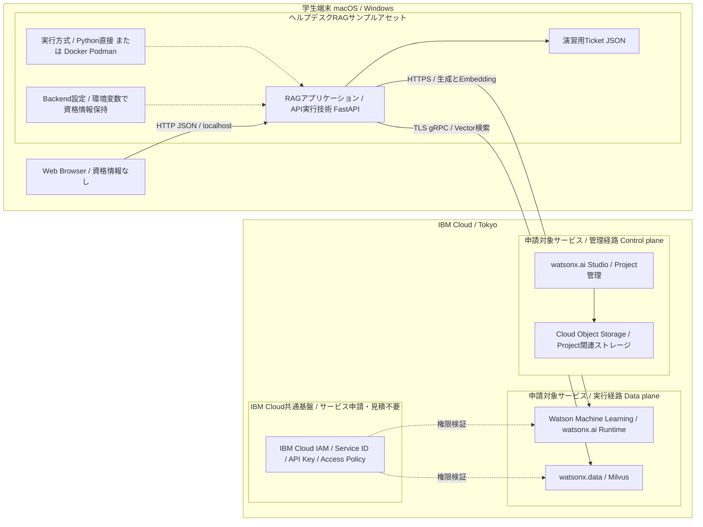
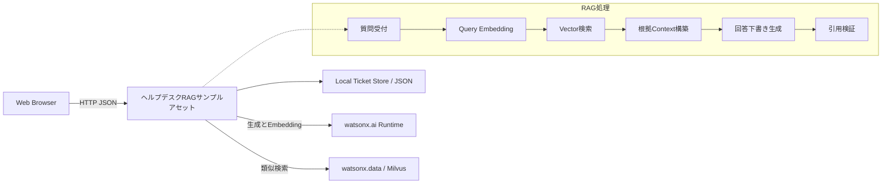
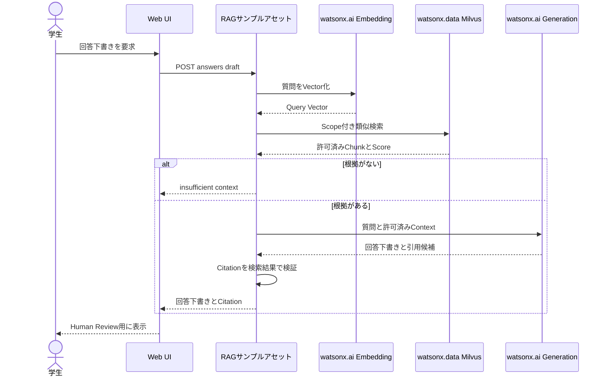
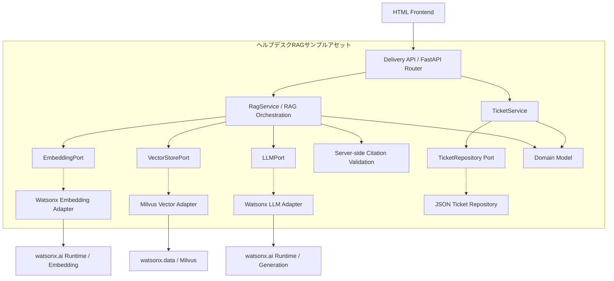
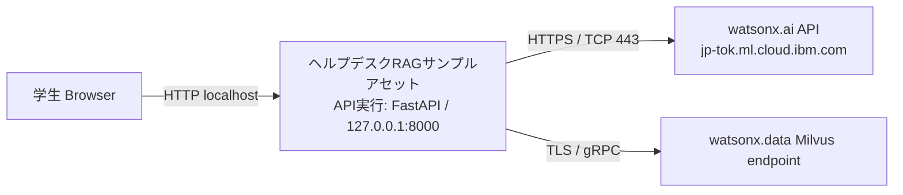
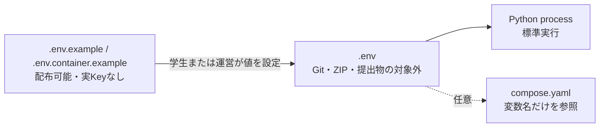

# ヘルプデスクRAGサンプルアセット 構成設計書

## 1. 採用構成

標準構成は、学生のMac／Windows上でヘルプデスクRAGサンプルアセットを実行し、IBM CloudのWatson Machine Learning（現行サービス名: watsonx.ai Runtime）が提供するwatsonx.ai APIとwatsonx.data Milvusへ接続する。サンプルアセットはRAG処理、Ticket API、静的Frontendを含み、Python／FastAPIはそのAPI実行技術として使用する。watsonx.ai StudioはProject管理、Cloud Object StorageはProject関連ストレージとして使用する。IBM Cloudへのアプリケーション配備は必須ではなく、Docker／Podmanは任意の実行方法とする。

利用者は8名（4名×2グループ）、IBM Cloudリージョンは東京（`jp-tok`）とする。基本見積もりでは両グループが1つのProjectとMilvus環境を共有する。

| レイヤー | 採用技術 |
|---|---|
| Frontend | HTML5。CSSとブラウザ標準JavaScriptは補助用途のみ |
| Backend | Python 3.14 / FastAPI / Uvicorn |
| LLM・Embedding | Watson Machine Learning（watsonx.ai Runtime）のwatsonx.ai API |
| Project管理 | watsonx.ai Studio |
| Project関連ストレージ | Cloud Object Storage |
| Vector DB | IBM Cloud watsonx.data Milvus |
| 実行基盤 | Mac／Windows上のPython直接実行。Docker／Podman Composeは任意 |

### 1.1 IBM Cloud申請対象と責務

申請対象は次の4サービスとする。IAMは認証・認可に使用するIBM Cloud共通機能であり、独立した有料サービス申請としては扱わない。

| 申請名 | 設計上の名称 | 責務 | アプリからの直接通信 |
|---|---|---|---|
| Watson Machine Learning | watsonx.ai Runtime | IBM提供の生成LLM／Embedding API、Token／RUのmetering | あり（HTTPS） |
| watsonx.ai Studio | watsonx.ai Studio | `WATSONX_PROJECT_ID`で指定するProjectの作成・管理 | 通常なし |
| Cloud Object Storage | Cloud Object Storage | watsonx.ai Projectの関連ストレージ | 通常なし |
| watsonx.data／Milvus | watsonx.data内のMilvusサービス | Chunk、Vector、検索metadataの保存と類似検索 | あり（TLS／gRPC） |

Watson Machine LearningはIBM Cloudの見積・申請画面で使用される名称として併記する。アプリケーション設計およびIBM SDK上では`watsonx.ai Runtime`として扱う。

### 1.2 図の使い分け

異なる抽象度を1枚へ混在させず、次の図を用途別に使い分ける。

| 図 | 表現範囲 | 主な利用者 |
|---|---|---|
| 配置・通信・信頼境界図 | 学生端末、IBM Cloud、実行経路、管理経路、資格情報の保持・検証 | 申請・セキュリティレビュー |
| コンテナ図 | Browser、RAGサンプルアセット、Ticket JSON、watsonx.ai Runtime、Milvus | システム全体の把握 |
| コンポーネント図 | RAGサンプルアセット内部のRAG処理、Router、Service、Port、Adapter、Repository | 開発・設計レビュー |
| UMLクラス図 | Service、Port、Adapterの依存・実装関係 | 実装レビュー |
| UMLシーケンス図 | 検索、生成、引用検証の呼び出し順 | 処理・障害レビュー |

### 1.3 配置・通信・信頼境界



MilvusはIBM Cloudの管理サービスであり、ローカルや`compose.yaml`内で起動しない。Python直接実行とコンテナ実行は同じ環境変数とAPI契約を利用する。

### 1.4 コンテナ図



watsonx.ai Studio、Cloud Object Storage、IAMは管理・認証基盤として配置図へ示し、RAGリクエストを表すコンテナ図には処理コンテナとして含めない。

## 2. RAGシーケンス



## 3. コンポーネント責務

本章のコンポーネント図はRAGサンプルアセット内部を主対象とする。FastAPIはHTTP/APIを実行する技術要素として配置し、図の中心はEmbedding、検索、Context構築、回答生成、引用検証からなるRAG処理とする。学生端末、Studio、Cloud Object Storage、IAMなどの配置・管理要素は1.3の配置図で表現し、ここでは重複させない。



図の矢印は論理依存と通信経路を示す。IBM CloudへFastAPIやFrontendを配備することを意味しない。Portを境界にProvider固有処理をAdapterへ閉じ込める。

| コンポーネント | 責務 | 保持データ |
|---|---|---|
| HTML Frontend | Ticket選択、検索・回答要求、引用表示。ビルド工程を持たない | Browser上の一時状態のみ |
| Python / FastAPI | validation、認可境界、RAG orchestration、Provider error変換、静的HTML配信 | process内cache |
| Ticket Repository | 架空TicketのCRUD | 直接実行は`data/runtime`、コンテナ時はnamed volume |
| Watsonx LLM Adapter | watsonx.ai生成API形式への変換 | 永続化なし |
| Watsonx Embedding Adapter | 文書・queryのVector化 | 永続化なし |
| Milvus Adapter | 類似検索とmetadata取得 | IBM Cloudのcollection |
| watsonx.ai Studio | Projectの作成・管理 | Project metadata |
| Cloud Object Storage | Project関連ストレージ | Project asset。業務文書本文の保存先には原則使用しない |
| Operator ingestion | Chunk、Embedding、upsert、削除同期 | 実行時のみ |

### 3.1 レイヤー境界

| レイヤー | 所属要素 | 責務 |
|---|---|---|
| Presentation / API | Router、HTTP request／response schema、exception handler | HTTP validation、response変換、Domain errorからHTTP statusへの変換 |
| Application | `TicketService`、`RagService`、LLM／Embedding／VectorStore／Repository Port | use case制御、外部依存の契約 |
| Domain | Ticketなどの業務entity、値、業務上のerror | HTTPやSDKに依存しない業務表現 |
| Infrastructure | `config.py`、Adapter、SDK、JSON／Milvus接続 | 設定読込、外部I/O、retry、provider固有error変換 |

現行の`domain/models.py`には業務entityとHTTP入出力modelが同居している。MVPでは互換性を優先して維持するが、API schemaの変更が内部modelへ波及し始めた場合は`api/schemas/`へ分離する。`config.py`はDomainには含めない。

### 3.2 RagServiceの責務と拡張条件

MVPでは理解しやすさを優先し、検索、閾値判定、Prompt構築、LLM呼び出し、JSON解析、引用検証を`RagService`で協調させる。最初からクラスを細分化しない。

次のいずれかが発生した責務から、`RetrievalService`、`PromptBuilder`、`AnswerGenerator`、`CitationValidator`へ分離する。

- 同一ロジックが3か所以上で重複する。
- 単独のテスト条件や変更頻度が明確に異なる。
- 複数の検索方式、Prompt形式、回答schemaを切り替える。
- `RagService`の条件分岐が増え、処理順や失敗点の把握が困難になる。

## 4. Milvus collection論理設計

| Field | 型の考え方 | 用途 |
|---|---|---|
| `chunk_id` | VARCHAR / primary key | 安定ID、upsert、削除 |
| `vector` | FLOAT_VECTOR | COSINE検索。次元はEmbedding modelと一致 |
| `document_id` | VARCHAR | 文書単位の削除・追跡 |
| `title` | VARCHAR | UI表示 |
| `text` | VARCHAR | Prompt contextとsnippet |
| `source` | VARCHAR | 引用元 |
| `document_type` | VARCHAR | FAQ、rule等のfilter |
| `category` | VARCHAR / nullable | 任意の絞り込み |
| `access_scope` | VARCHAR | 呼出主体に許可された文書だけを検索するためのfilter |
| `is_active` | BOOL | 無効文書を検索候補から除外するfilter |
| `updated_at` | VARCHARまたはTIMESTAMP / nullable | 更新追跡 |
| `content_hash` | VARCHAR | 差分Embedding、重複検出 |

長文がMilvusのfield上限やIBM Cloudのメッセージ上限に近づく場合、本文をObject Storageへ置き、Milvusには参照IDと短いsnippetだけを保持する。

検索式には、少なくとも呼出主体から決定した`access_scope`と`is_active == true`を含める。Client requestから任意のscopeを直接指定させず、検索後に除外する方式だけには依存しない。

### 4.1 Collection contract

運営側はcollectionと対になるmanifestを管理する。

```json
{
  "schema_version": 1,
  "collection": "helpdesk_knowledge_v1",
  "embedding_provider": "watsonx",
  "embedding_model": "configured-model-id",
  "dimension": 768,
  "metric": "COSINE",
  "chunk_schema_version": 1,
  "required_fields": [
    "chunk_id", "document_id", "text", "access_scope", "is_active", "vector"
  ]
}
```

ModelまたはChunk schema変更時は新しいcollectionへ投入し、評価後に`MILVUS_COLLECTION`を切り替える。異なるEmbedding空間のVectorを同じcollectionへ混在させない。

## 5. ネットワーク



- Host portは既定でloopbackだけにbindする。
- watsonx.aiとMilvusへのoutbound通信を許可する。
- 「外部公開なし」はFastAPIへのInbound公開を行わないという意味であり、IBM Cloudのmanaged API endpointへのOutbound接続は必要となる。
- TLS証明書検証を無効にしない。
- IBM Cloudの接続画面に表示されるgRPC host／portから、検証済みPyMilvus形式の`MILVUS_URI`を構成する。
- Proxy環境ではPython processまたは任意のコンテナへ必要最小限の`HTTPS_PROXY`と`NO_PROXY`を追加する。

## 6. 秘密情報



教材では`.env`を利用する。Frontend、配布ZIP、提出物、image、log、health responseへ秘密情報を出さない。Composeを選択し、別名を使う場合だけ`APP_ENV_FILE`で指定する。

## 7. 実行方式

### 7.1 Python直接実行（標準）

```bash
cp .env.container.example .env
uv sync --extra watsonx --extra milvus --extra dev
uv run uvicorn helpdesk.main:app --app-dir backend/src --host 127.0.0.1 --port 8000
```

- Mac／Windowsの詳細は`docs/環境構築手順_Mac_Windows.md`を参照する。
- IBM Cloudへアプリケーションをデプロイしない。
- localhost以外へbindしない。
- JSON Ticket Repositoryを使用するためUvicorn workerを1に固定する。

### 7.2 Compose（任意）

- `app`だけを起動し、FrontendはFastAPIから静的配信する。
- Node.jsやFrontendフレームワークを実行時依存にしない。
- `read_only: true`、`cap_drop: ALL`、`no-new-privileges`を設定する。
- Ticket更新領域だけnamed volumeへmountする。
- `/tmp`はtmpfsとする。
- JSON Ticket Repositoryを使用するMVPではUvicorn workerを1に固定する。複数worker化するときはDB Repositoryへ置き換える。
- Compose起動時にcollection作成・削除・一括ingestionを自動実行しない。
- readinessは実行モード別に判定する。Mock／NumPyではseed、runtime書込、local index manifest、dimensionを確認する。watsonx.ai／Milvusではwatsonx.ai必須設定の存在、seed、runtime書込、Milvus接続・認証、database、collection、必須field、Vector次元、collection contractを確認する。
- watsonx.aiへの実推論は課金、遅延、rate limitを避けるためhealth checkでは行わない。Credential値とModel IDの存在・形式は起動時に検証し、有効性とModel availabilityは検索／回答APIの実行時に検出して503へ変換する。

Docker:

```bash
docker compose config
docker compose up --build -d
docker compose logs -f app
docker compose down
```

Podman:

```bash
podman compose config
podman compose up --build -d
podman compose logs -f app
podman compose down
```

Docker／Podmanが利用できないことを演習参加の阻害条件にしない。

## 8. 環境変数マッピング

| 分類 | 変数 |
|---|---|
| watsonx.ai共通 | `WATSONX_URL`, `WATSONX_PROJECT_ID`, `WATSONX_API_KEY`。Projectはwatsonx.ai Studioで管理し、Cloud Object Storageを関連付ける |
| 生成 | `WATSONX_MODEL_ID`, `LLM_*` |
| Embedding | `WATSONX_EMBEDDING_MODEL_ID`, `EMBEDDING_DIMENSION` |
| Milvus | `MILVUS_URI`, `MILVUS_USERNAME`, `MILVUS_PASSWORD`, `MILVUS_DATABASE`, `MILVUS_COLLECTION`, `MILVUS_TLS`。URIはgRPC host／portから構成する |
| 検索 | `VECTOR_TOP_K`, `VECTOR_MIN_SCORE` |
| アプリ | `APP_PORT`, `LOG_LEVEL`, data directory |

Model変更時はcollectionをそのまま再利用しない。新しいcollectionを作成して再Embeddingし、評価後に`MILVUS_COLLECTION`を切り替える。

## 9. 障害時動作

| 障害 | 動作 |
|---|---|
| watsonx.ai必須設定不足 | 起動時の設定検証に失敗する。値は応答・ログへ含めない |
| watsonx.ai認証・Model利用失敗 | 検索／回答APIで503。Credentialやprovider詳細を応答へ含めない |
| watsonx.ai timeout / rate limit | 上限付きretry後に503 |
| Milvus認証・接続失敗 | readiness 503、検索・回答API 503 |
| collectionなし | readiness 503。アプリが勝手に作成しない |
| schema／Vector次元／collection contract不一致 | readiness 503。既存collectionへ自動補正・混在投入しない |
| 根拠0件 | LLMを呼ばずHuman Review要求を返す |
| Ticket volume書込失敗 | 更新失敗として返し、成功扱いしない |

## 9.1 Ingestion運用

文書検証とMilvus同期はWebアプリ起動から分離し、運営担当が明示的に実行する管理commandとする。

```bash
uv run python -m helpdesk.ingestion validate
uv run python -m helpdesk.ingestion sync --dry-run
uv run python -m helpdesk.ingestion sync
```

これらは目標interfaceであり、実装は後続作業とする。`validate`と`--dry-run`は外部更新を行わない。`sync`は安定した`chunk_id`による冪等なbatch upsertと削除同期を行う。Compose起動、FastAPI startup、readinessからcollection create／drop／reindex／syncを呼ばない。

## 10. IBM Cloud準備チェックリスト

- [ ] Watson Machine Learning（watsonx.ai Runtime）instanceを用意した
- [ ] watsonx.ai StudioでProjectを1件作成し、Project IDを取得した
- [ ] Cloud Object Storage instanceをProjectへ関連付けた
- [ ] 利用者8名（4名×2グループ）として利用量を見積もった
- [ ] 申請4サービスを東京リージョン（`jp-tok`）で用意した。watsonx.data追加不能時は未申請として追跡した
- [ ] 生成ModelとEmbedding Modelをリージョンで利用できる
- [ ] 最小権限のAPI Keyを用意した
- [ ] watsonx.data Milvus serviceを作成した
- [ ] IBM Cloud画面からgRPC host／portを取得した
- [ ] `ibmlhapikey_<username>`または`ibmlhtoken_<username>`形式を使用している
- [ ] API Key方式ではwatsonx.dataをプロビジョニングしたアカウントでKeyを発行した
- [ ] Milvus server versionに対応するPyMilvus major／minorを固定した
- [ ] Milvus databaseとcollectionを作成した
- [ ] Embedding次元とcollection schemaが一致する
- [ ] collection contractのModel、dimension、metric、Chunk schemaが一致する
- [ ] `access_scope`と`is_active`を含む必須fieldを作成した
- [ ] 文書Chunkを同一Embedding modelで登録した
- [ ] アプリの接続主体へ検索権限を付与した
- [ ] 予算、rate limit、演習終了後のKey失効担当を決めた
- [ ] 利用期間を2026年10月10日から12月31日として申請した
- [ ] `docs/IBM_Cloud申請見積.md`でTokenとRUを算定した
- [ ] IBM Cloudへのアプリ配備とContainer Registryを基本申請へ含めていない

## 11. 公式資料

- [IBM Cloud: Connecting to Milvus service](https://cloud.ibm.com/docs/watsonxdata?topic=watsonxdata-conn-to-milvus)
- [IBM Cloud: Access management and authentication](https://cloud.ibm.com/docs/watsonxdata?topic=watsonxdata-access_mgt)
- [IBM Cloud: Working with Milvus](https://cloud.ibm.com/docs/watsonxdata?topic=watsonxdata-working_with_milvus)
- [IBM watsonx.ai: Converting text to embeddings](https://dataplatform.cloud.ibm.com/docs/content/wsj/analyze-data/fm-embedding.html?context=wx)
- [IBM watsonx.ai Python SDK](https://ibm.github.io/watsonx-ai-python-sdk/foundation_models.html)
- [PyMilvus package and compatibility table](https://pypi.org/project/pymilvus/)
